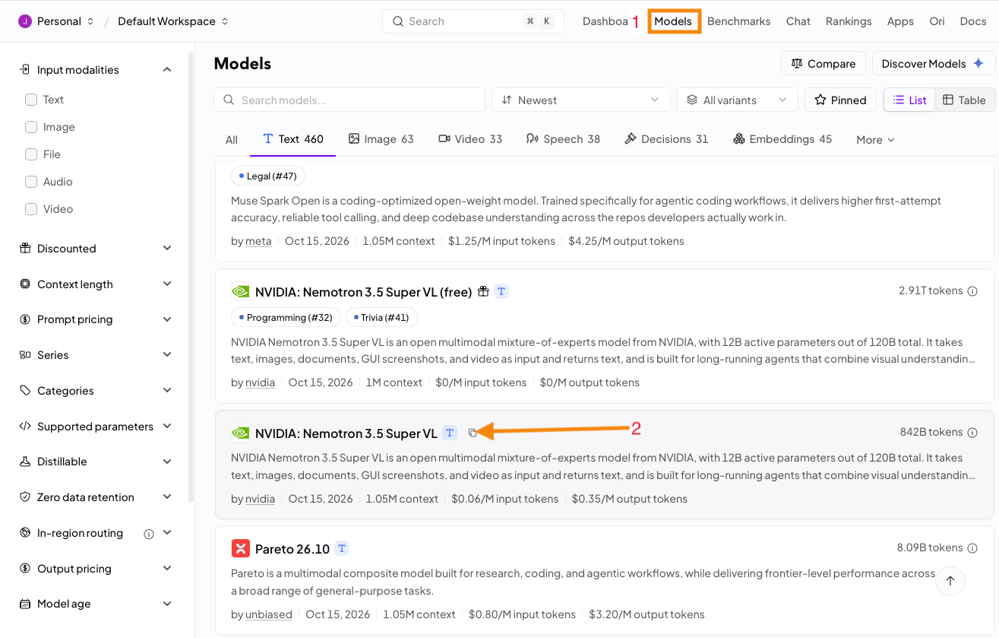
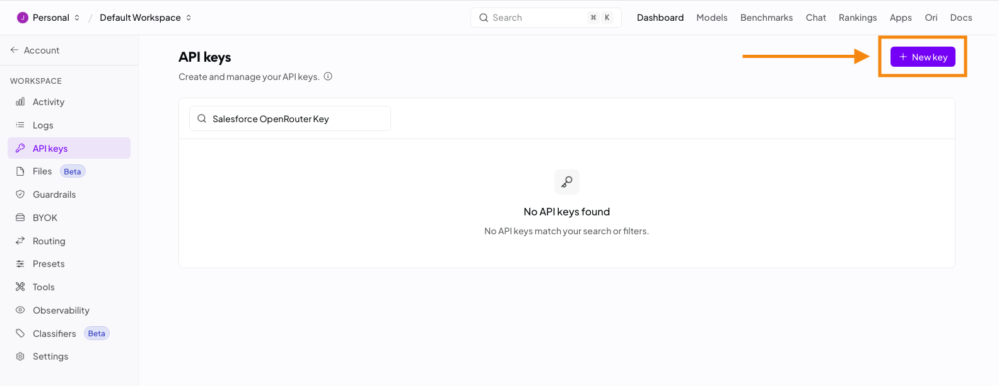
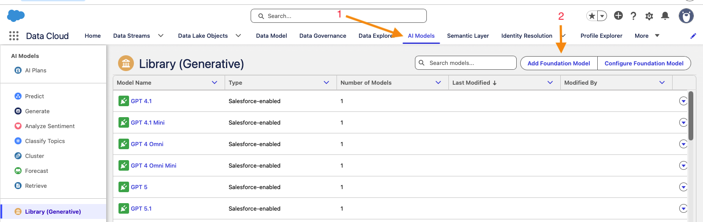
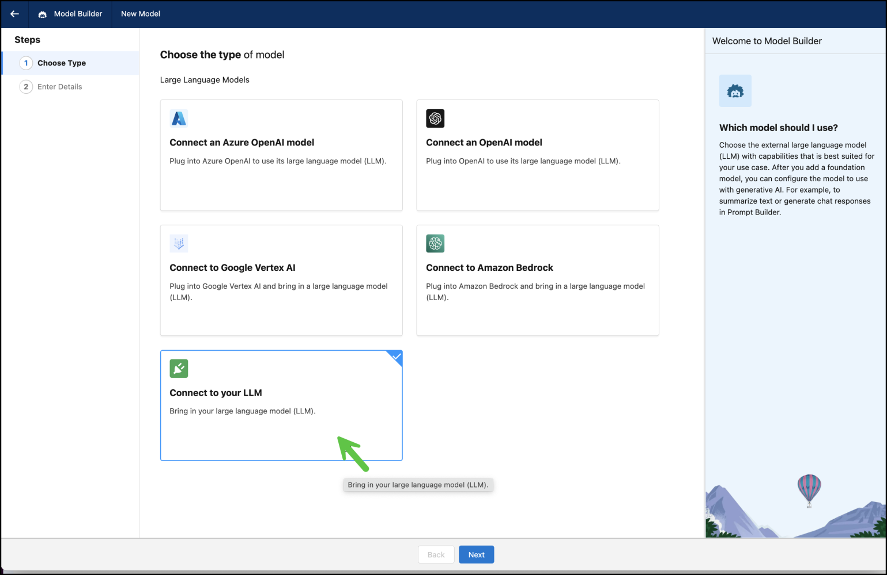
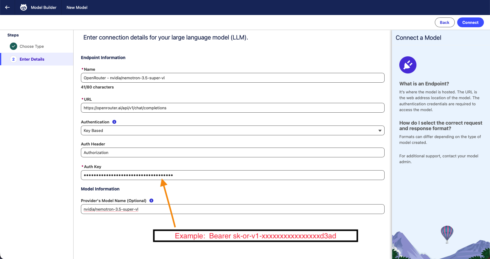
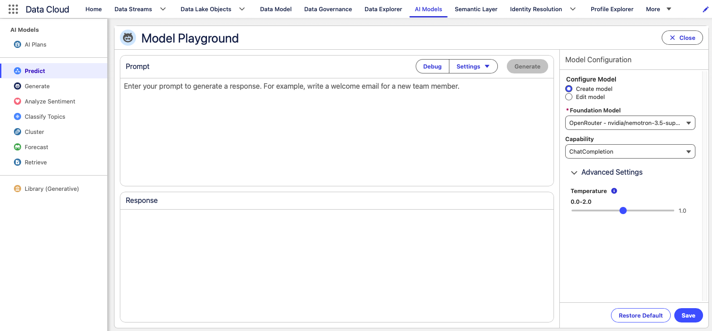
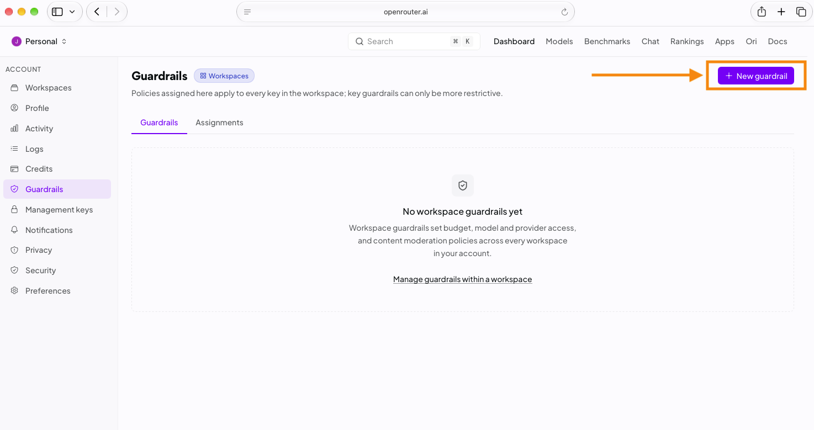
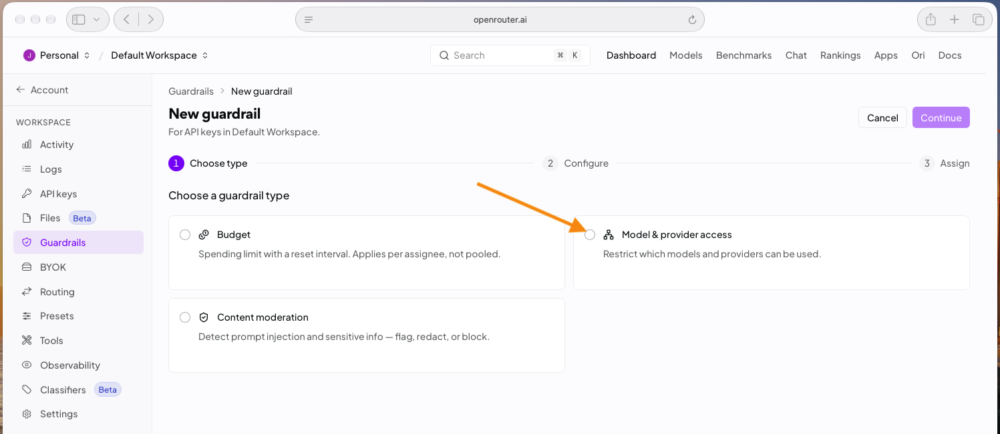
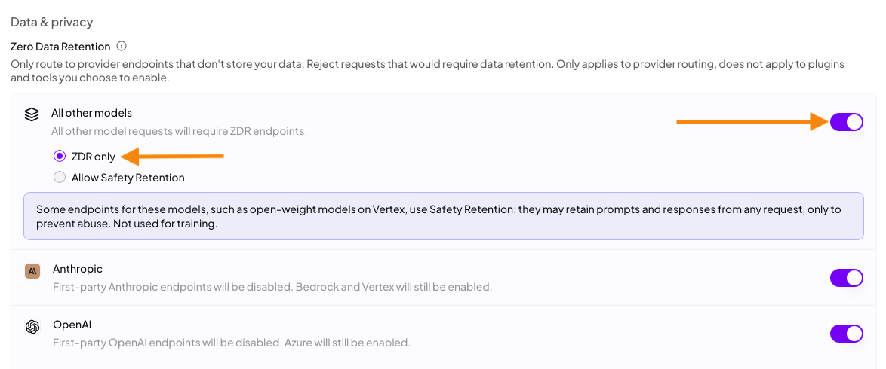
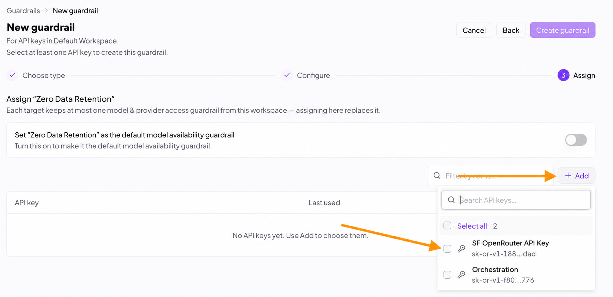

# LLM Open Connector + OpenRouter

Implement Salesforce's [LLM Open Connector](https://opensource.salesforce.com/einstein-platform/docs/apis/llm-open-connector) with [OpenRouter](https://openrouter.ai/), a unified API that provides access to hundreds of AI models across multiple inference providers.

This guide walks through creating an OpenRouter API key, configuring a model in Salesforce, and optionally enabling Zero Data Retention (ZDR) to protect sensitive information. **No coding or additional infrastructure is required.** Best of all, requests made through Salesforce's configured model are processed through the **Einstein Trust Layer**, providing Salesforce's built-in AI security and governance capabilities.

<!-- truncate -->
## Prerequisites
1. An [OpenRouter account](https://openrouter.ai/). You can sign up for free and add credits.
2. An [OpenRouter API key](https://openrouter.ai/settings/keys) created for this integration. Treat it as a secret.

> **Tip:** Use a dedicated OpenRouter API key for Salesforce so you can apply separate usage limits and privacy guardrails.

## Step 1. Select a Model in OpenRouter

1. Open the [OpenRouter model catalog](https://openrouter.ai/models).
2. Select a model suitable for your use case and copy its exact model ID, including the provider prefix (for example, `openai/gpt-4o`, if available in your account).
3. If you plan to enforce ZDR, verify that at least one endpoint for your chosen model is ZDR-eligible. See [Enabling Zero Data Retention with OpenRouter](#enabling-zero-data-retention-with-openrouter).

**Selected model ID (in this example):** nvidia/nemotron-3.5-super-vl

## Step 2. Create an OpenRouter API Key

1. In OpenRouter, navigate to [API Keys](https://openrouter.ai/settings/keys).
2. Create a dedicated key for Salesforce.
3. Configure any desired key-level spending limit.
4. Click Create and jot your API key down for later steps.

> **Note:** Make sure to paste this key somewhere handy because you are going to need it and once you close the window it will no longer be available to you.

## Step 3. Add a Foundation Model in Salesforce

1. In Salesforce, open **Einstein Studio / Model Builder** (the exact navigation may vary by org and Salesforce release).
2. Choose **Add Foundation Model**.

3. Select **Connect Your LLM** / **Bring Your Own LLM**.

4. Complete the endpoint configuration:

| Field | Suggested value | Notes |
| --- | --- | --- |
| **Name** | `OpenRouter - [Model Display Name]` Example:  **OpenRouter - nvidia/nemotron-3.5-super-vl**    | A descriptive Salesforce connection name. |
| **URL** | `https://openrouter.ai/api/v1/chat/completions` | Use Chat Completions, **not** `/api/v1/responses`. |
| **Authentication** | `Key Based` | Based on the Model Builder UI tested for this recipe. |
| **Auth Header** | `Authorization` | OpenRouter uses bearer authorization. |
| **Auth Key** | `Bearer YOUR_OPENROUTER_API_KEY` Example: **`Bearer sk-or-v1-xxxxxxxxxxxxxxxxd3ad`**  | Include `Bearer` followed by one space and your key. |
| **Provider's Model Name** | `[REPLACE_WITH_TESTED_MODEL_ID]` Example:  **nvidia/nemotron-3.5-super-vl**  | Exact OpenRouter model ID, including the prefix and slash. |

5. Save the model connection, if Salesforce validates it successfully.

> **Important:** Confirm by clicking Connect and then saving and it will test and verify the connection is working.
## Step 4. Create a Configured Model and Test
1. Open the newly connected model in the Model Library. (It will automatically open this page upon a successful test in the prior step)
2. Select **New Configuration**.
3. Under settings select 1 response per prompt and determine if you want data masking of PII. A temperature of 1.0 is usually a good conservative starting point.
4. Before saving type a message into the prompt and verify that you get a response when you click the Generate button.
5. Once you have confirmed it works click on the save button.

Congradulations you can now use your new model OpenRouter model configuration directly from Salesforce. But before you do I reccomend you take a few extra steps to set up Zero Data Retention guardrails on your OpenRouter API key we are using. With ZDR enabled and assigned to the API key we are telling OpenRouter that you don't want your companies data to be retained nor do you want it to be used for training their models.

If you want this additional level of protection for your organizations data then please follow the steps below.

## Enabling Zero Data Retention with OpenRouter

OpenRouter routes requests among inference endpoints, and different endpoints can have different data-retention policies.  ZDR is an endpoint-level retention policy intended to prevent the eligible inference provider from storing prompt and response content after processing.

For a declarative Salesforce connection we can use an **OpenRouter Guardrail** assigned to the dedicated **Salesforce API key**. This enforces routing requirements without modifying the payload that Salesforce sends.

### Step 1. Create a Guardrail

1. In OpenRouter, navigate to your [Account Workspace](https://openrouter.ai/workspaces/) and locate **Guardrails**. In some workspace layouts, Guardrails are found under **Workspaces → Guardrails**. Click New Guardrail.

2. Choose th guardrail type -> **Model & provider access** and then click continue

3. Enter a Guardrail name such as "Zero Data Retention"
4. If you want maxmimum ZDR protection select all toggles in the Data & privacy section and elect ZDR only when presented.

5. In the Data Training section toggle off all of the options:
* Allow paid endpoints that train on request data
* Allow free endpoints that train on request data
* Allow free endpoints that publish prompts

6. Click Continue then Confirm & Save

7. On the New guardrail assign screen click the Add button and select the box next to the API key you want to assign this to. Click the Add 1 API key button that appears and then when you are done click Create guardrail.

## References

- [Salesforce: LLM Open Connector + Grok](https://opensource.salesforce.com/einstein-platform/grok)
- [Salesforce: LLM Open Connector API](https://opensource.salesforce.com/einstein-platform/docs/apis/llm-open-connector)
- [OpenRouter: Model Catalog](https://openrouter.ai/models)
- [OpenRouter: Guardrails](https://openrouter.ai/docs/guides/features/guardrails/overview)
- [OpenRouter: Zero Data Retention](https://openrouter.ai/blog/insights/zero-data-retention/)
